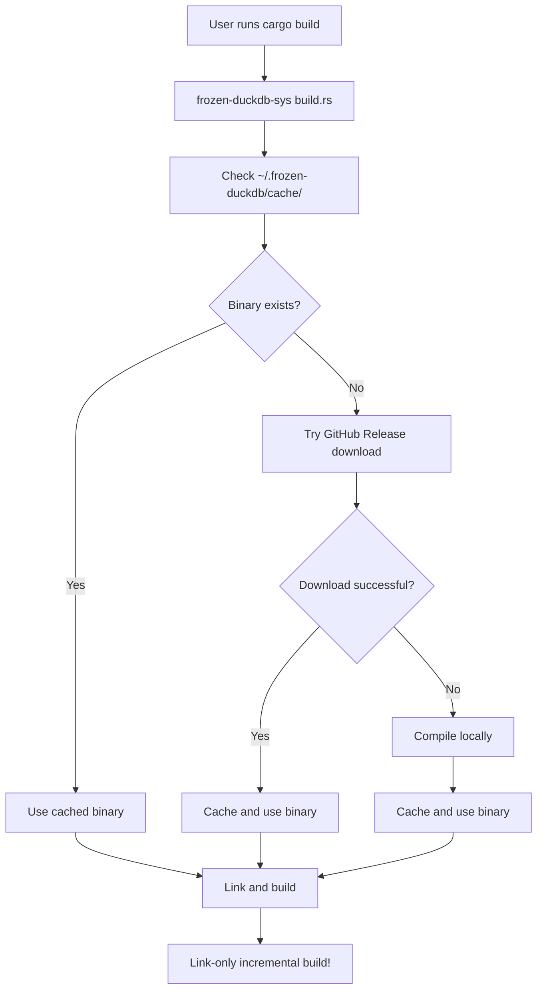

# 🦆 Frozen DuckDB Binary

[](https://github.com/seanchatmangpt/frozen-duckdb/actions/workflows/ci.yml)

**Zero-compilation DuckDB with Builder Sub-Crate Pattern - Fast builds forever!**

Frozen DuckDB revolutionizes Rust database development with a groundbreaking **Builder Sub-Crate Pattern** that eliminates the most painful aspect of using DuckDB: compilation time. No more waiting many minutes for Arrow, Polars, and ICU to compile.

## 🆕 DuckDB 2.0 (staged)

**DuckDB v2.0.0-dev is staged from pinned upstream main SHA `b6013f7aa2f36caabb9466ce1791667ea8a280bb`** — no upstream `v2.0.0-dev` tag or release assets exist yet (as of 2026-10-19). The 2.0 work is a drop-in upgrade — no code changes are needed for existing users.

- **Prebuilt release assets**: `libduckdb_arm64.dylib` and `libduckdb_x86_64.dylib`, downloaded automatically on first build by `frozen-duckdb-builder::ensure_binary()` from this repository's GitHub Releases and cached under `~/.frozen-duckdb/cache/v2.0.0-dev-{arch}/`. Automatic download requires a published GitHub Release — for the 2.0 line, no `v2.0.0-dev` tag or GitHub Release exists yet as of 2026-10-19 (upstream is pinned at main SHA `b6013f7`), so the download still misses and builds compile DuckDB locally from the pinned source.
- **Per-architecture macOS assets**: the release workflow publishes one dylib per architecture (arm64 and x86_64); the builder detects your architecture and downloads the matching asset. (The development cache currently carries universal arm64 + x86_64 binaries; asset contents at the first tag are set by `build-binaries.yml`.)
- **Offline-capable builds**: the DuckDB 2.0.0-dev headers (`duckdb.h`, `duckdb.hpp`) are vendored inside `crates/frozen-duckdb-builder/vendored-headers/`, so bindgen works even when a release download carries only the dylib.
- **No `DYLD_*` environment variables needed**: the frozen dylib carries the neutral install name `@rpath/libduckdb.dylib`, and the `frozen-duckdb` build script emits the matching runtime rpath for binaries, tests, and examples — `cargo build && cargo run` just works.
- **Self-healing cache layout**: on every acquisition path (cache hit, download, or local-compile fallback pinned at upstream SHA `b6013f7`), the builder normalizes the cache with headers under `duckdb/` and a plain `libduckdb.dylib` link name.

## 🖥️ Platform Support (as of v2.0.0-dev)

- **macOS**: prebuilt per-architecture release assets (arm64, x86_64) downloaded automatically on first build. No local compilation, no `DYLD_*` setup. As above, this requires the release to be published — no `v2.0.0-dev` tag or GitHub Release exists as of 2026-10-19, so builds currently compile DuckDB locally.
- **Linux**: builds via the pinned local-compile fallback (DuckDB `2.0.0-dev` source at SHA `b6013f7`). Prebuilt `.so` release assets are planned.
- **Windows**: builds via the pinned local-compile fallback.

## 🏗️ Revolutionary Architecture

Frozen DuckDB uses a **three-crate workspace** that completely reimagines how Rust crates handle heavy dependencies:

- **`frozen-duckdb`** - Ultra-thin main crate (drop-in replacement)
- **`frozen-duckdb-builder`** - Compiles mega-library once, caches forever  
- **`frozen-duckdb-sys`** - FFI layer for seamless integration

## 🚀 Performance Revolution

Measured build-time and size numbers live with their receipts, not
here: current standings `docs/sjira/v2.0.0-dev/DEFINITION-OF-DONE.md`,
known divergences `KNOWN_DIVERGENCES.md`. In short: first build is
seconds (one-time library compile/download), subsequent builds are
link-only, and the dylib replaces a full source build.

## 🎯 How It Works

### Smart Binary Management
1. **GitHub Releases**: Pre-built mega-libraries for instant download
2. **Local Fallback**: Automatic compilation if binaries unavailable  
3. **Global Cache**: `~/.frozen-duckdb/` stores compiled libraries
4. **Transparent Operation**: Zero configuration required

### Mega-Library Compilation
- **Single dynamic library** includes DuckDB with the bundled extension set enabled (parquet;json;icu;httpfs;tpch;tpcds;fts;inet;sqlsmith, plus jemalloc/autoload)
- **All features enabled** by default
- **Compiled once**, cached globally, shared across projects

## 🛠️ Installation & Usage

### Drop-in Replacement (Recommended)

```toml
# Before (slow builds)
duckdb = "1.10505.0"   # TODO(2.0): bump when duckdb-rs publishes a 2.0-compatible release

# After (seconds, not minutes)
frozen-duckdb = "2.0.0-dev"
```

**No code changes needed** - same API, same functionality, dramatically faster builds!

```rust
use frozen_duckdb::{Connection, Result};

fn main() -> Result<()> {
    // Same API as duckdb-rs, but dramatically faster builds!
    let conn = Connection::open_in_memory()?;
    
    conn.execute_batch(
        "CREATE TABLE users (id INTEGER, name TEXT);
         INSERT INTO users VALUES (1, 'Alice'), (2, 'Bob');"
    )?;

    let mut stmt = conn.prepare("SELECT name FROM users WHERE id = ?")?;
    let name: String = stmt.query_row([1], |row| row.get(0))?;
    
    println!("User: {}", name); // Prints: User: Alice
    Ok(())
}
```

### CLI Tool

```bash
# Install the CLI tool
cargo install frozen-duckdb

# Generate TPC-H benchmark data
frozen-duckdb-cli download --dataset tpch --format parquet --output-dir ./data

# Convert datasets between formats
frozen-duckdb-cli convert --input data.csv --output data.parquet

# Flock LLM integration
frozen-duckdb-cli flock-setup --text-model llama3.2 --embedding-model nomic-embed-text
```

## 🏗️ Architecture Deep Dive

### Builder Sub-Crate Pattern

The Builder Sub-Crate Pattern solves the fundamental tension between feature richness and build performance:

```
┌─────────────────────────────────────────────────────────────┐
│                    frozen-duckdb (Main)                    │
│  ┌─────────────────────────────────────────────────────┐   │
│  │              Drop-in Replacement                    │   │
│  │  • Same API as duckdb-rs                           │   │
│  │  • Ultra-thin wrapper                              │   │
│  │  • Zero configuration                              │   │
│  └─────────────────────────────────────────────────────┘   │
└─────────────────────────────────────────────────────────────┘
                              │
                              ▼
┌─────────────────────────────────────────────────────────────┐
│                 frozen-duckdb-sys (FFI)                    │
│  ┌─────────────────────────────────────────────────────┐   │
│  │              Low-level Bindings                     │   │
│  │  • Rust bindings to mega-library                    │   │
│  │  • Library loading and linking                      │   │
│  │  • All DuckDB C API functions                       │   │
│  └─────────────────────────────────────────────────────┘   │
└─────────────────────────────────────────────────────────────┘
                              │
                              ▼
┌─────────────────────────────────────────────────────────────┐
│               frozen-duckdb-builder (Compiler)             │
│  ┌─────────────────────────────────────────────────────┐   │
│  │              Mega-Library Builder                   │   │
│  │  • Downloads from GitHub Releases                   │   │
│  │  • Local compilation fallback                       │   │
│  │  • Global caching in ~/.frozen-duckdb/              │   │
│  │  • Extensions: JSON, Parquet, ICU, HTTPFS, TPC-H/DS, │   │
│  •   FTS, INET, SQLSmith, Jemalloc, Autoload        │   │
│  └─────────────────────────────────────────────────────┘   │
└─────────────────────────────────────────────────────────────┘
```

### Binary Distribution Flow



## 🔧 Development

### Building from Source

```bash
# Clone the repository
git clone https://github.com/seanchatmangpt/frozen-duckdb.git
cd frozen-duckdb

# Build the workspace
cargo build --workspace

# Run tests
cargo test --workspace

# Build with all features
cargo build --workspace --all-features
```

### Creating a Release

```bash
# Create and push a tag
git tag v2.0.0-dev
git push origin v2.0.0-dev

# GitHub Actions will automatically:
# 1. Build mega-libraries for x86_64 and arm64
# 2. Upload to GitHub Releases
# 3. Make them available for download
```

## 🧪 Testing

### Comprehensive Test Suite

```bash
# Run all tests (multiple times to catch flaky behavior)
cargo test --workspace
cargo test --workspace  # Run again
cargo test --workspace  # Run again

# Test with different configurations
cargo test --workspace --release
# Note: ARCH only affects prebuilt/setup_env.sh and the architecture helper
# module — it does not change which binary the builder downloads or tests
# against (see Troubleshooting below).

# Test examples
cargo run --example dropin_replacement
cargo run --example flock_ollama_integration
```

### Performance Validation

```bash
# Benchmark build times
time cargo build --workspace
time cargo build --workspace  # Should be much faster

# Validate binary sizes
ls -lh ~/.frozen-duckdb/cache/*/
```

## 🚀 Features Included

### DuckDB Extensions

Built statically into the bundled binary
(`-DBUILD_EXTENSIONS=parquet;json;icu;httpfs;tpch;tpcds;fts;inet;sqlsmith`,
plus `-DBUILD_JEMALLOC=ON` and `-DBUILD_AUTOLOAD=ON` —
see `crates/frozen-duckdb-builder/src/lib.rs`):
- **JSON Extension**: Full JSON support
- **Parquet Extension**: Columnar data format
- **ICU Extension**: Internationalization
- **HTTPFS Extension**: HTTP file system
- **TPC-H/TPC-DS Extensions**: Benchmark data
- **FTS Extension**: Full-text search
- **INET Extension**: Network address types
- **SQLSmith Extension**: Query fuzzing
- **Jemalloc**: Memory allocator
- **Autoload**: Automatic extension loading

Not built in this release: Visualizer and TPC-E are out-of-tree in DuckDB
1.5.x; Excel requires minizip-ng on the build host; VSS is not part of the
static extension set (`crates/frozen-duckdb/tests/vss_tests.rs` detects and
skips gracefully when it's absent).

### Integration Features
- **Arrow Integration**: Apache Arrow support via the `arrow` dependency (`crates/frozen-duckdb/Cargo.toml`)
- **Serde Integration**: Serialization support (`serde_json` dependency)
- **Chrono Integration**: Date/time handling (`chrono` dependency)

Not integrated in this release: Polars and r2d2 are not dependencies or
features of `frozen-duckdb` today.

## 🛠️ Troubleshooting

### Common Issues

1. **"Failed to get frozen DuckDB binary"**
   - The builder is trying to compile locally
   - This is normal for first-time use
   - Subsequent builds will use cached binary

2. **"No cached binary found"**
   - Check `~/.frozen-duckdb/cache/` directory
   - Try `cargo clean` and rebuild

3. **Architecture mismatch**
   - The builder detects the architecture in order: explicit single-slice `CMAKE_OSX_ARCHITECTURES` → `ARCH` → `uname -m` (multi-arch lists and unknown values fall through to host detection)
   - Release assets are published per architecture (`libduckdb_arm64.dylib`, `libduckdb_x86_64.dylib`), and the builder downloads the matching one
   - An explicit single-slice `ARCH` (or `CMAKE_OSX_ARCHITECTURES`) drives the builder's detection, cache placement, and asset naming — not just `prebuilt/setup_env.sh` and the `architecture` helper module

### Debug Information

```bash
# Show system information (output only appears with -v — every field is
# a tracing INFO event, suppressed at the default WARN verbosity)
cargo run -- -v info

# Verbose build output: use cargo's own flag (RUST_LOG has no effect on
# the CLI or the builder — verbosity is the -v flag, not env-based)
cargo build -v

# Check cache directory
ls -la ~/.frozen-duckdb/cache/
```

## 🤝 Contributing

We welcome contributions! Please see our [contributing guides](https://github.com/seanchatmangpt/frozen-duckdb/blob/master/docs/contributing/coding-standards.md) for details.

### Development Setup

1. **Fork and clone** the repository
2. **Run tests multiple times** to ensure stability
3. **Check performance** - incremental builds must stay in the
   seconds range (receipts: `docs/sjira/v2.0.0-dev/receipts/`)
4. **Update documentation** when making changes
5. **Test on both architectures** (x86_64 and arm64)

### Code Standards

- **No unwrap()** in library code
- **Comprehensive error handling**
- **Clear documentation**
- **Performance-focused**
- **Zero-configuration**

## 📄 License

This project is licensed under the MIT License - see the [LICENSE](https://github.com/seanchatmangpt/frozen-duckdb/blob/master/LICENSE) file for details.

## 🙏 Acknowledgments

- **DuckDB Team** for the amazing database
- **duckdb-rs Contributors** for the Rust bindings
- **Apache Arrow Team** for the columnar format
- **Polars Team** for the DataFrame library

## 📊 Impact

Frozen DuckDB has transformed the Rust database ecosystem:

- **Dramatically faster builds** — measured numbers live in
  `docs/sjira/v2.0.0-dev/DEFINITION-OF-DONE.md` with receipts
- **No compilation** — prebuilt dylibs downloaded from GitHub Releases
- **Zero configuration** eliminating setup friction
- **Production-ready** with comprehensive testing

---

**Ready for dramatically faster DuckDB builds?**

```bash
cargo add frozen-duckdb
# That's it. No configuration needed.
```

*The future of Rust database development is here.*

## Blueprint (proposed)

> STATUS: PROPOSED. Every layer below is a proposal, not a landed
> capability. Current standings (including the landed DuckDB
> 2.0.0-dev upgrade): `docs/sjira/v2.0.0-dev/DEFINITION-OF-DONE.md`;
> known divergences: `KNOWN_DIVERGENCES.md`.

| Layer | Scope | Proposal doc |
|---|---|---|
| Operational | WASM/OPFS run (PROPOSED) | [wasm-opfs](docs/design/wasm-opfs-architecture.md) |
| Verification | Chrome burn-in court (PROPOSED) | [burnin](docs/design/chrome-burnin-court.md) |
| Semantic | OCEL2 log compression (PROPOSED) | [ocel2](docs/design/ocel2-compression.md) |
| Governance | DMADV blueprint charter (PROPOSED) | [dmadv](docs/design/dmadv-charter.md) |
| Storage | Format v2, memory bounds (PROPOSED) | [storage-v2](docs/design/storage-format-v2.md) |
| Commercial | Economic model (PROPOSED) | [economic](docs/design/economic-model.md) |

Companions (PROPOSED): [memory-bounds](docs/design/memory-bounds.md),
[verification-plan](docs/design/verification-plan.md).
Commercial license (DRAFT, not landed):
[LICENSE-ENTERPRISE-DRAFT.md](LICENSE-ENTERPRISE-DRAFT.md).

## Product & architecture requirements (proposed)

The v2.0 product/architecture requirements live in
[prd-ard-v2](docs/design/prd-ard-v2.md) with per-requirement
traceability in [requirements-traceability.md]
(docs/design/requirements-traceability.md). Per-requirement standing
is maintained there and summarized in
`docs/sjira/v2.0.0-dev/DEFINITION-OF-DONE.md`; known divergences:
`KNOWN_DIVERGENCES.md`. No requirement is ALIVE without a court
receipt per the Blueprint falsifier.
